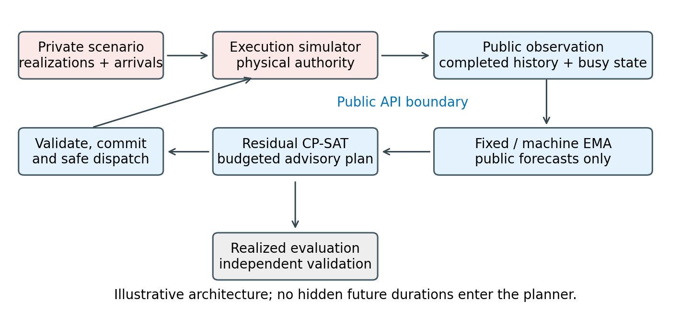
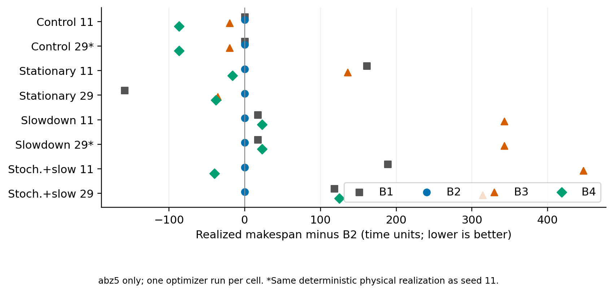
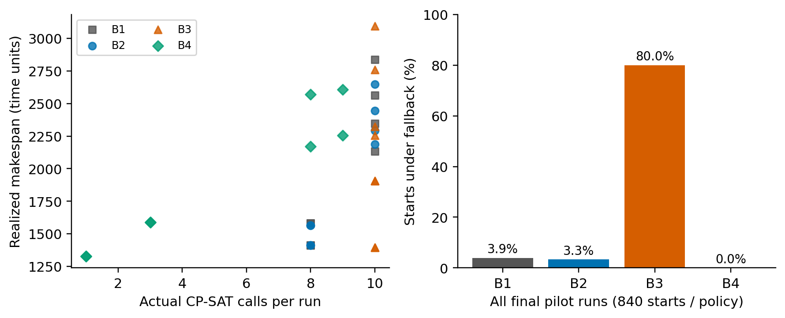

# Adaptive Scheduling under Uncertain Processing Times

**Independent research portfolio · Dongjun Miao** | [GitHub profile](https://github.com/dongjun-miao)

## Overview

Processing-time uncertainty can invalidate a schedule even when its nominal optimization model is feasible. This independent research engineering project investigates how forecast updates and replanning triggers affect realized job-shop scheduling performance under controlled information and computation budgets. It implements an exact-time execution simulator, public-history forecasts, residual OR-Tools CP-SAT planning, immutable running commitments, safe dispatch, and independent execution and plan validation. Fixed nominal forecasts are compared with machine-level exponential moving average calibration; periodic, public-event and forecast-threshold triggers share the same planning machinery. A small controlled pilot includes a synthetic diagnostic instance and the public abz5 benchmark under four duration regimes. Full traces are preserved in a compressed data archive (extract before rerunning figures or the data audit), exposing forecast attribution, solver budgets and fallback behavior. The contribution is a reproducible experimental foundation and a transparent empirical evaluation. No new scheduling algorithm, general superiority, institutional collaboration or publication acceptance is claimed.

## Research questions

- Does improved forecasting translate into better realized makespan?
- How do periodic, event and threshold triggers behave under a common allocated effort cap?
- How do optimization cost, fallback and plan commitment affect interpretation?

## System overview



Private future durations and arrivals stay inside execution. Forecast-feasible plans guide starts only after actual predecessor and machine checks.

## Implemented policies

|Policy|Forecast|Planning trigger|
|---|---|---|
|B0|Nominal information|Release-time FIFO; job/operation ID ties; no solver|
|B1|Fixed nominal|Initial + periodic|
|B2|Machine EMA, alpha 0.25|Initial + periodic|
|B3|Same EMA|Initial + public completion/arrival|
|B4|Same EMA|Relative forecast change >0.25; cooldown; new-work integration|

B2-B1 studies forecast updating. B3-B2, B4-B2 and B4-B3 compare trigger mechanisms with EMA fixed. These compare full policies under a budget cap, including fallback and realized compute differences. B3-B1 does not isolate triggering. B0 was tested in earlier Phase 2A; it is not part of the final four-policy plot.

## Experimental setup

Final Phase 2C: two instances (5-operation diagnostic; 100-operation, 10-machine abz5), four regimes, seeds 11/29, one optimizer repetition: 64 attempts. Regimes: nominal deterministic; operation-keyed stationary multipliers in {1,2}; deterministic machine-0 slowdown; stochastic multipliers plus slowdown. Slowdown doubles durations for operations starting at/after time 3 (tiny) or 200 (abz5). Deterministic seeds are duplicated realizations, not independent samples. All pilot jobs arrive at zero; arrival handling is exercised in tests.

Period/cooldown: 3 tiny, 200 abz5. EMA uses only completed public durations; exact rational estimates are ceiled to positive integers. Running residual estimate is max(1, estimated total minus elapsed). OR-Tools 9.11.4210, worker 1, seed 0; per-call deterministic effort 0.02 units, cumulative allocated cap 0.20 units/run; separate wall safety 10 seconds/call. Effort units are not seconds. Realized computation can differ across policies. Primary metric: makespan; secondary: two forecast error metrics, coverage, solve cost and fallback.

## Key findings

1. Forecast updating is not universally beneficial: abz5 stationary B2-B1 is -161 at seed 11 but +159 at seed 29 ([paired summary data](phase2c-final-pilot/pairs.csv); Figure 2).
2. Event-triggered B3 is fallback-heavy: 672/840 starts (80.0%) across the final pilot were dispatched under fallback; 3,846 fallback callbacks represent eight episodes, not solver failures ([figure data](figures/figure_data_manifest.json); Figure 3).
3. B4 also has mixed outcomes: stochastic-plus-slowdown B4-B2 is -40/+125 ([paired data](phase2c-final-pilot/pairs.json)).
4. Start-time and plan-time predictions differ: 221/812 planned B2 starts use different values at start versus commitment. Fallback has no invented plan-time coverage ([audit](phase2c-final-pilot/independent-audit.json)).

## Results



Figure 2. All eight abz5 cells; differences relative to B2, lower is better. Duplicate deterministic seeds are marked. No confidence intervals or significance claims.



Figure 3. Left: abz5 makespan and actual calls. Right: operation-weighted fallback fraction across all 64 final runs. Fallback-heavy B3 outcomes are effects of the budgeted policy, not pure trigger effects.

## Reproducibility

Python 3.12.14 was tested on Windows. From the repository/extracted portfolio root:

```powershell
python -m venv .venv
.venv/Scripts/python.exe -m pip install -r requirements-lock.txt
.venv/Scripts/python.exe scripts/fetch_benchmark.py
.venv/Scripts/python.exe scripts/extract_results.py
.venv/Scripts/python.exe -B -m unittest discover -s tests -v
.venv/Scripts/python.exe -B scripts/smoke_baseline.py
.venv/Scripts/python.exe -B run_phase2c.py new-pilot-output
.venv/Scripts/python.exe -B audit_phase2c.py phase2c-final-pilot
.venv/Scripts/python.exe -B scripts/build_figures.py
```

Use `.venv/bin/python` on Unix (untested). Output experiment directories must not exist. Environment creation/install syntax is standard; this delivery reuses the existing locked environment, not a fresh network install. All subsequent commands were executed here, except a full new pilot was not rerun for presentation. Exact-action replay is distinct from reoptimization reproducibility; wall-time historical divergence remains documented in docs/26-30. Figure data extraction was run twice and matched exactly.

PDFs are generated by `scripts/build_documents.py` with ReportLab (`requirements-portfolio.txt`), using the bundled document runtime in this delivery. LaTeX source is supplied; no TeX compiler was available, so the PDFs are ReportLab-rendered rather than TeX-compiled.

## Repository navigation

- [Research report](report/research_report.pdf) / [editable TeX](report/research_report.tex)
- [One-page application summary](application/one_page_research_summary.pdf)
- `engine.py`, `residual.py`: physical execution and public residual optimization
- `policies.py`, `triggers.py`, `forecasting.py`: shared coordinator and policies
- `prediction_metrics.py`, `tests/`: forecast attribution and regression checks
- `run_phase2c.py`, `audit_phase2c.py`: final pilot and independent raw reconstruction
- `figures/`, `scripts/`: source data manifest, reproducible figures and documents
- `phase2c-final-pilot/`: final CSV/JSON summary; full raw run records are compressed in [`data/phase2c-raw-details.zip`](data/phase2c-raw-details.zip) (extract with `scripts/extract_results.py` before re-auditing or regenerating figures)
- [Evidence audit](docs/43_portfolio_evidence_audit.md), [release review](docs/44_publication_readiness_review.md)

## Methodological safeguards and limitations

Public forecasts cannot access Scenario references through the policy API. Fraction event times, immutable observations, frozen running machines, independent feasibility checks, exact decision replay and full status/budget logging protect experimental integrity. This is cooperative Python isolation, not a malicious-process security sandbox. Start-time and decision-time MAE/RMSE have separate coverage; errors on policy-dependent exposures are not a common held-out prediction test.

Only one public benchmark instance and two seeds were used. Static benchmark topology is combined with synthetic uncertainty; arrival safety tests do not establish arrival-performance effectiveness. Deterministic search limits do not guarantee cross-platform identical results. Budget exhaustion, fallback, stale wakeups and allocation timing complicate causal interpretation. Scope is fixed-machine, nonpreemptive JSP; no FJSP execution or universal performance claim.

## References and attribution

- [TU/e benchmark repository](https://github.com/ai-for-decision-making-tue/Job_Shop_Scheduling_Benchmark_Environments_and_Instances), pinned commit `d088a26582f5cb79c6b4f2ad94f68ac7c50878cb`. See upstream for its paper citation.
- [Google OR-Tools: The Job Shop Problem](https://developers.google.com/optimization/scheduling/job_shop), official formulation/example.
- [NIST/SEMATECH: EWMA Control Charts](https://www.itl.nist.gov/div898/handbook/pmc/section3/pmc324.htm), standard exponential-smoothing definition; our ratio calibration is not a control-chart analysis.

`fixtures/abz5` is **not redistributed** in this repository pending clarification of benchmark-data rights. Run `scripts/fetch_benchmark.py` to retrieve the audited file from the pinned TU/e upstream checkout. Upstream credit: [TU/e benchmark](https://github.com/ai-for-decision-making-tue/Job_Shop_Scheduling_Benchmark_Environments_and_Instances). No blanket license is assigned to this independent project code; contact the author about reuse. This is independent work, not an HKU or Professor Max Shen collaboration.
